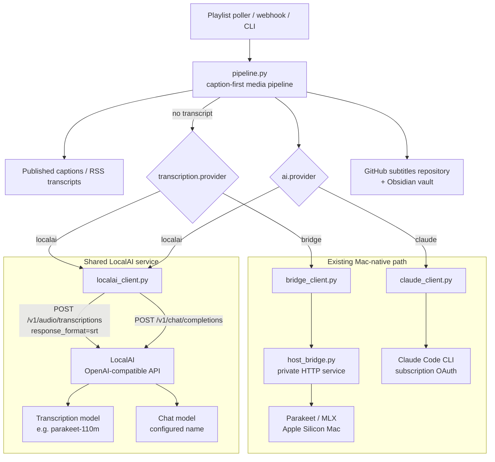

# Dual-provider AI architecture

This design keeps the current Mac-native path running while LocalAI becomes a
shared, OpenAI-compatible AI service for this pipeline and other applications.
Each provider is selected independently, so migration does not require a
cutover.



## Runtime request flow

```mermaid
sequenceDiagram
    participant Trigger as CLI / playlist / webhook
    participant Pipeline as pipeline.py
    participant LegacySTT as Mac bridge
    participant LocalAI as LocalAI API
    participant Claude as Claude CLI
    participant Git as GitHub repos

    Trigger->>Pipeline: process_input(media URL or file)
    Pipeline->>Pipeline: prefer existing captions / RSS transcript
    alt No published transcript; transcription.provider = bridge
        Pipeline->>LegacySTT: authenticated custom /transcribe request
        LegacySTT-->>Pipeline: SRT + plain text
    else No published transcript; transcription.provider = localai
        Pipeline->>LocalAI: POST /v1/audio/transcriptions (SRT)
        LocalAI-->>Pipeline: SRT
    end
    alt ai.provider = claude
        Pipeline->>Claude: summary and tag prompts
        Claude-->>Pipeline: markdown summary + tags
    else ai.provider = localai
        Pipeline->>LocalAI: POST /v1/chat/completions (summary and tags)
        LocalAI-->>Pipeline: markdown summary + tags
    end
    Pipeline->>Git: commit transcript and Obsidian note
```

## Configuration matrix

| Capability | Current default | LocalAI option | Selection |
| --- | --- | --- | --- |
| Fallback transcription | `host_bridge.py` + Parakeet/MLX | LocalAI `/v1/audio/transcriptions` | `transcription.provider` |
| Summary and tags | Claude Code CLI | LocalAI `/v1/chat/completions` | `ai.provider` |
| Authentication | Bridge bearer token / Claude OAuth | Optional LocalAI bearer key | respective config section |

## Deployment boundary

LocalAI should be operated as its own service: it owns model loading, API
authentication, quotas, and availability. The pipeline only needs its base URL,
model names, and optionally an API key. Other internal services can use the
same LocalAI URL and their own credentials without calling this pipeline.

Keep LocalAI private by default (localhost, a private Docker network, or a
private overlay network). If it is shared beyond a trusted network, enable its
API-key/user controls and put it behind your normal TLS and access-control
layer. The pipeline's public webhook token does not secure LocalAI.

## Migration plan

1. Start LocalAI and load one transcription model plus one chat model.
2. Set `transcription.provider: localai`; leave `ai.provider: claude` to
   compare transcript quality without changing summaries.
3. Set `ai.provider: localai` after validating summary and tag quality.
4. Keep the bridge and Claude configuration until the LocalAI path has proven
   reliable; either capability can be reverted independently.
